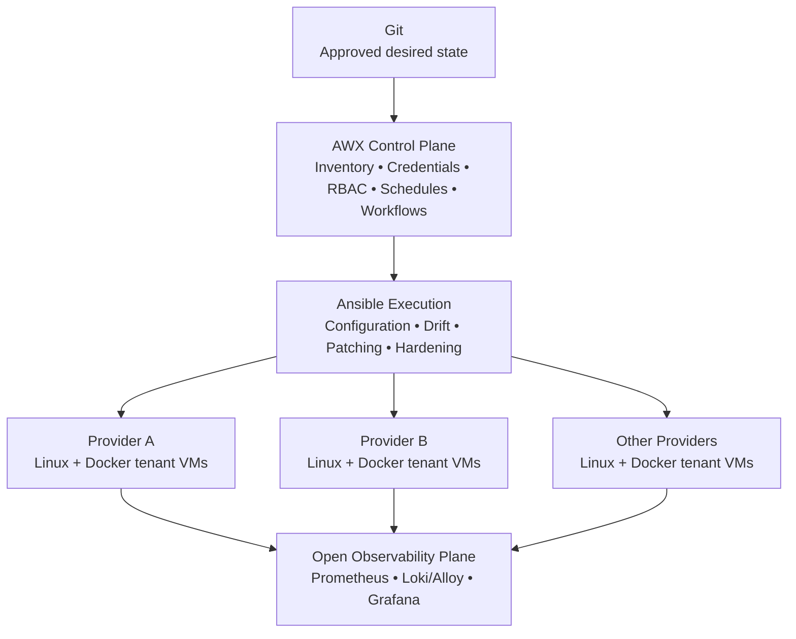
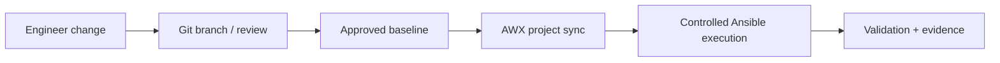

# Architecture Blueprint

## Objective

Create a vendor-neutral management plane for 50 isolated Linux/Docker tenant appliances distributed across multiple hosting providers.

## Control Plane

Git is the source of approved configuration. AWX synchronizes automation content from Git and provides inventory, credentials, RBAC, schedules, workflows and job history. Ansible executes configuration, compliance, patching and validation against the managed hosts.

## Connectivity

AWX must have a controlled management path to every VM. Depending on provider topology this can use private routing, VPN connectivity, bastion/jump hosts or AWX execution nodes positioned closer to remote environments. Publicly exposing SSH is not the default architecture.

## Inventory Model

Hosts can be grouped by provider/location, operating-system family, environment, tenant and maintenance group. Canary hosts are a deliberate maintenance group used before wider rollout.

## Credentials

Credentials are stored in AWX or an integrated secrets platform, never in inventory or Git. Automation accounts use least privilege. Credentials should be scoped by environment or host group where practical to reduce blast radius rather than sharing one unrestricted private key across the full estate.

## Change Flow

## Design Principle

The cloud providers supply compute and network infrastructure; the governance plane remains independent of any single provider. This gives the fleet one consistent operational model while preserving tenant isolation.
