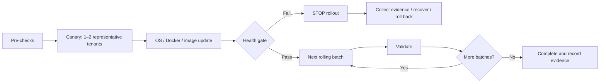

# Automated Multi-Container Patching Lifecycle

## Objective

Patch the operating system, Docker runtime and application containers without creating concurrent fleet-wide downtime.

Because each tenant is hosted on a standalone VM, a reboot or Docker restart can interrupt that individual tenant. The design therefore controls blast radius through canaries and rolling batches rather than claiming per-tenant zero downtime.

## Workflow

## 1. Pre-Checks

Validate connectivity, disk capacity, current service/container state, application health and recovery readiness before maintenance begins.

## 2. Canary

One or two representative hosts receive the change first. The workflow does not progress until automated health checks pass.

## 3. OS Security Patching

Ansible applies approved security updates. Reboot occurs only when required. AWX/Ansible waits for the host to return and then validates the operating system, Docker and application stack.

For Debian/Ubuntu-family hosts, the proof-of-concept invokes the distribution's `unattended-upgrade` mechanism. In production, its allowed origins must be explicitly aligned with the client's approved security repositories and patch policy before execution.

## 4. Docker Daemon Updates

Docker updates use the same rolling strategy. The workflow records running containers, applies the package update, restarts/reboots only as required and validates that Docker and the expected containers recover correctly.

## 5. Application Runtime Updates

PHP and microservice upgrades are delivered as immutable, versioned container images. Compose manifests pin approved versions or digests. A new image is pulled, the affected service is recreated, health checks run and the previous known-good image/digest remains available for rollback.

## 6. Batch Control

Ansible `serial` and AWX workflow stages constrain concurrency. Each batch must pass its health gate before the next batch starts. Failure thresholds stop the rollout rather than allowing the same defect to propagate across all tenants.

## Recovery

Container rollback returns to the previous known-good image/digest. OS/kernel recovery may use a supported package rollback when appropriate; otherwise recovery relies on the pre-maintenance snapshot/backup or rebuild procedure.
